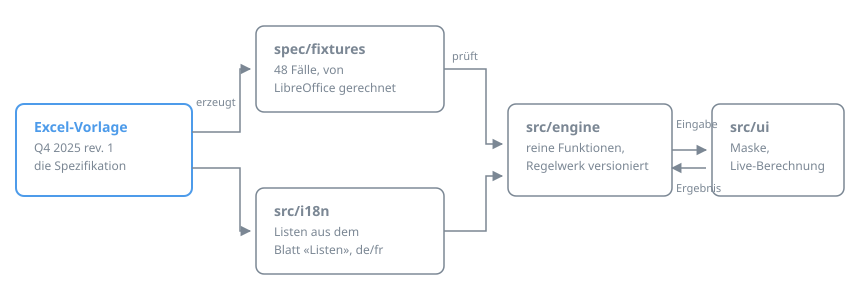

# Kalkulationstool 2.0 – Machbarkeitsnachweis

Web-Ablösung des Excel-Kalkulationstools (Q4 2025 rev. 1) für MFP-Offerten.
Die Rechenlogik ist aus dem Excel nachgebaut und wird gegen 48 Testfälle
geprüft, die **aus dem Excel selbst** erzeugt wurden.



## Was drin ist

| Phase des Vorgehens | Stand |
|---|---|
| 0 Spezifikation | `spec/calc-spec.md`, `spec/glossary.md`, 48 Fixtures aus dem Excel |
| 1 Rechenkern | `src/engine` – reines TypeScript, ohne Abhängigkeiten, alle Fixtures grün |
| 2 Web-Basis | Eingabemaske mit Live-Berechnung, Sprachschalter DE/FR |
| 3–6 | nicht gebaut: Produkt-DB, Offerten-Ausgabe, Dokumente, Anmeldung, Admin |

Die Berechnung läuft vollständig im Browser. Kein Server, keine Datenbank,
keine Anmeldung – und damit auch keine Kundendaten, die irgendwohin gehen.
Eingaben bleiben im `localStorage` des Browsers.

## Ausprobieren

```bash
npm install
npm run dev          # http://localhost:5173
```

In der Maske oben rechts **Beispiel laden** – das ist das Pro-Memoria-Beispiel
aus dem Blatt «Miete Graphax» (bizhub C360i, 13 680 Listenpreis, 5 % Rabatt,
48 Monate), ergänzt um Solutions, Transport und Pauschalen. Das Excel rechnet
für diesen Fall einen Vertragswert von 31 606.00 und eine Monatspauschale von
998.75; die Maske zeigt dieselben Zahlen, geprüft in `tests/beispiel.test.ts`.

## Prüfen

```bash
npm test             # 48 Fixtures + Beispiel der Maske
npm run lint         # Typprüfung
npm run build        # Produktionsbau nach dist/
```

Die Fixtures stammen nicht aus der Engine, sondern aus dem Excel:
`scripts/extract_fixtures.py` setzt definierte Eingaben in eine Kopie der
Vorlage, lässt LibreOffice headless neu rechnen und liest die Ergebniszellen
aus. Neu erzeugen (braucht `libreoffice-calc` und `openpyxl`):

```bash
npm run fixtures
```

Abgedeckt sind Kauf, Miete Graphax, ZKB-Leasing, Spezial Miete und Spezial
Leasing über die Laufzeiten 12 bis 72 Monate, Vertragswerte von 1 500 bis
300 000, mit und ohne Solutions, mit Restwert aus altem Vertrag, mit
Supportabzug, mit von Hand gesetzten Netto-Preisen und in den Fällen, in denen
das Excel keinen Faktor kennt.

## Veröffentlichen

`netlify.toml` liegt im **Wurzelverzeichnis des Repositorys** und zeigt auf
dieses Unterverzeichnis. Beim Verbinden des Repositorys in Netlify sind deshalb
keine Einstellungen von Hand nötig:

| Einstellung | Wert | steht in |
|---|---|---|
| Base directory | `kalkulationstool` | `netlify.toml` |
| Build command | `npm ci && npm run build` | `netlify.toml` |
| Publish directory | `dist` (relativ zur Base) | `netlify.toml` |
| Node-Version | 22 | `netlify.toml` |

Ein Punkt braucht eine Entscheidung: Netlify veröffentlicht standardmässig den
Produktions-Branch, meist `main`. Dieser Machbarkeitsnachweis liegt auf
`claude/netlify-poc-working-te6b0j`. Entweder den Branch in Netlify als
Produktions-Branch setzen, oder Branch-Deploys aktivieren und die
Branch-URL verwenden, oder nach `main` zusammenführen.

Ohne Netlify: `npm run build` erzeugt `dist/`, einen Ordner mit statischen
Dateien, der auf jedem Webserver liegen kann.

## Aufbau

```
spec/
  excel/            Vorlage Q4 2025 rev. 1 (Quelle der Wahrheit)
  calc-spec.md      jede Formel als Regel mit Excel-Zelle
  glossary.md       CIF, LP, Netto VP, Amortisation, H14, B17 …
  fixtures/         48 Testfälle, aus dem Excel erzeugt
  vorlage-defaults.json  Werte der leeren Vorlage
scripts/
  extract_fixtures.py    Excel → Fixtures (LibreOffice headless)
  extract_listen.py      Blatt «Listen» → src/i18n/listen.de.json
  faelle.py              Definition der Testfälle
  eingabezellen.py       welche Zellen Eingaben sind
src/
  engine/           Rechenkern: rein, ohne I/O, ohne Abhängigkeiten
  i18n/             de.json, fr.json, Listen aus dem Excel
  ui/               Eingabemaske und Ergebnisbereich
tests/              Fixtures gegen die Engine
```

## Bekannte Abweichungen im Excel

Vollständig in `spec/calc-spec.md`, Abschnitt 11. Die zwei, die eine
Entscheidung brauchen:

1. **Für 12 Monate Laufzeit ist kein Mietfaktor hinterlegt** – die Spalte im
   Blatt «Miete Graphax» ist leer, überschrieben mit «Faktor offen – noch zu
   definieren». Die Rate wird damit 0. Die Maske meldet das (`W101`).
2. **Der KAM-Haken ist in der Vorlage gesetzt.** Jede neue Kalkulation rechnet
   dadurch mit der günstigsten Faktorstufe «ab 250 000», unabhängig vom
   Vertragswert. Die Web-Maske startet ohne Haken und weist darauf hin, sobald
   er gesetzt wird (`W201`).

Beides ist im Excel so und wird hier bewusst nicht stillschweigend korrigiert.

## Nächste Schritte

1. `spec/calc-spec.md` gegen das Excel durchsehen und die zwei offenen Punkte
   entscheiden.
2. Französische Fassung der Vorlage (rev. 1 F) beschaffen – die Listen in
   `src/i18n/listen.fr.json` sind bisher übersetzt, nicht belegt.
3. Aktuelle Preisliste als CSV für die Produkt-Datenbank (Phase 3).
4. Hosting und Entra-SSO klären, bevor Phase 3 beginnt.
